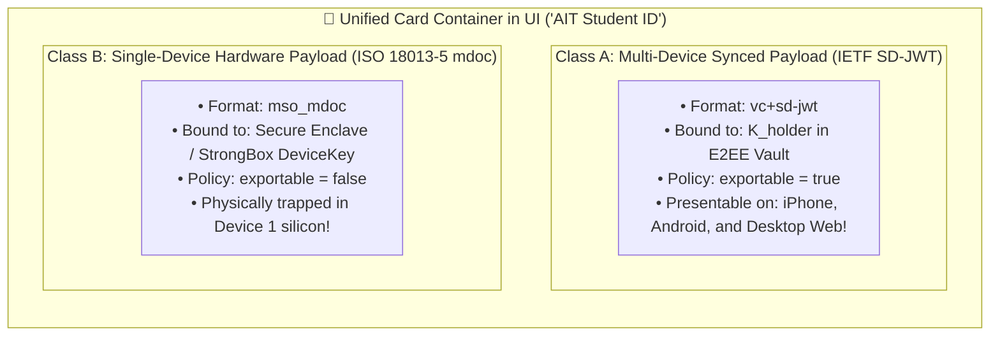
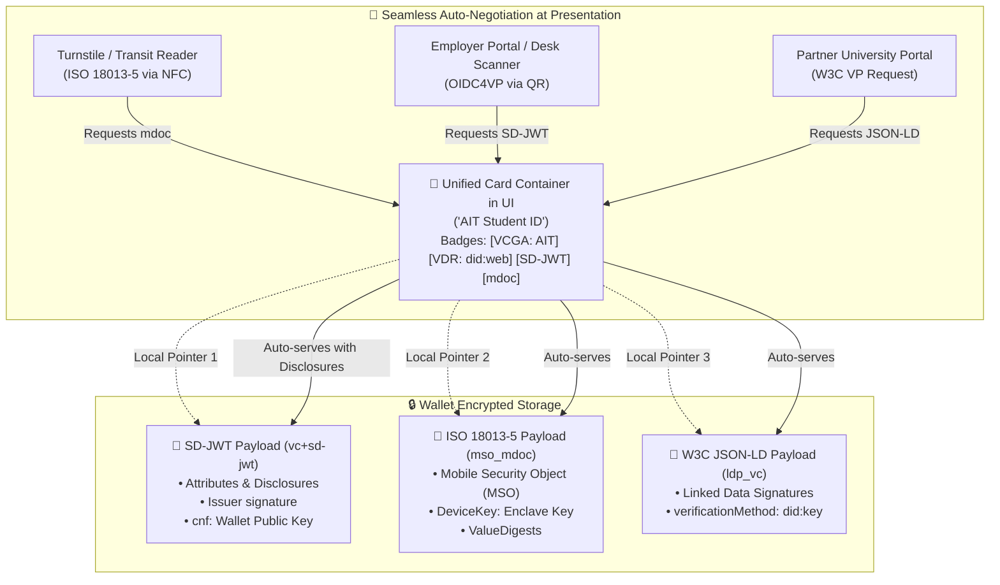
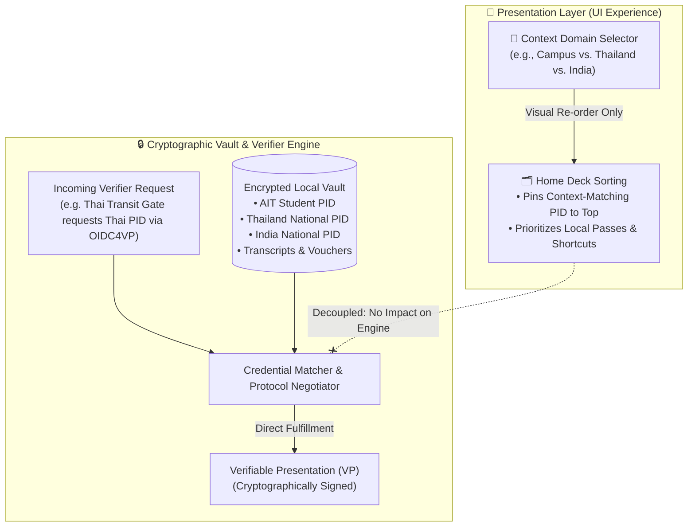
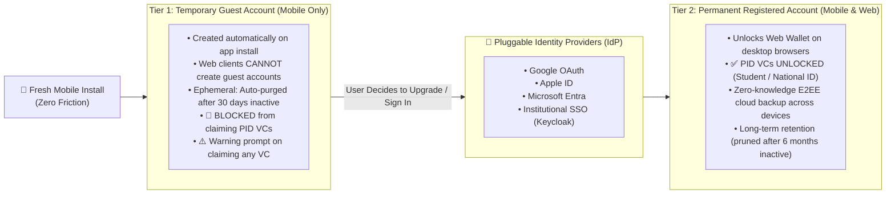

# AIT Wallet (Universal Verifiable Credential Wallet)

[](https://w3.org/TR/vc-data-model-2.0/)
[-green.svg)](#architecture)
[-orange.svg)](https://github.com/mosip/inji-wallet)
[](LICENSE)

The **AIT Wallet** is an open, universal decentralized identity and Verifiable Credential (VC) wallet. Engineered on international open standards, it functions as an agnostic, privacy-preserving digital vault capable of receiving, holding, and presenting cryptographically verifiable credentials from **any Governance Authority (VCGA) and Verifiable Data Registry (VDR) worldwide**.

---

## 🌐 Core Capabilities: The 3 Foundational Design Pillars

### 1. Envelope Encryption with Multi-Recipient Key Wrapping (Zero-Knowledge Sync)
To enable seamless multi-device access and ensure users never lose their credentials upon device loss or replacement, the wallet implements a **Zero-Knowledge Encrypted Data Vault (EDV)** leveraging **Envelope Encryption with Multi-Recipient Key Wrapping** (conforming to W3C CCG Encrypted Data Vault specifications and WebAuthn PRF key derivation).

This architecture adopts the proven zero-knowledge security models established by leading privacy-preserving platforms:

| Organization / Platform | Standard & Security Model Equivalent |
| :--- | :--- |
| **Apple** | **CloudKit End-to-End Encryption (E2EE) / Keychain "Circle of Trust"** |
| **Signal Messenger** | **Secure Value Recovery (SVR)** |
| **Matrix / Element** | **Secure Secret Storage and Sharing (SSSS)** |
| **1Password / Bitwarden** | **Zero-Knowledge Client-Side Encrypted Vault** |

#### 🔐 Cryptographic Key Hierarchy (DEK vs. KEK)
The wallet separates bulk data encryption from device authentication using a two-tier cryptographic hierarchy:
1. **Data Encryption Key (DEK) — Master Vault Key (`K_vault`)**:
   * A 256-bit symmetric key (`AES-256-GCM`) generated locally on the client.
   * Encrypts the user's complete vault (Verifiable Credentials, metadata, and the keychain of `K_holder` private/public keypairs) into a single encrypted blob (`Vault_Data.enc`).
   * The BFF **never** sees or stores `K_vault` in plaintext.
2. **Key Encrypting Keys (KEK) — Per-Device Key Wrappers**:
   * Derived locally on each authorized device via **WebAuthn PRF (Pseudo-Random Function)** from hardware biometrics (Face ID, Touch ID, Windows Hello), or via **Argon2id** memory-hard key derivation on budget devices lacking hardware enclaves.
   * Each authorized device encrypts a copy of `K_vault`, producing a compact ~64-byte **Key Wrapper** (`Wrapper_DeviceA`, `Wrapper_DeviceB`).
   * Adding an Android phone or Desktop Web Wallet simply registers a new wrapper using a 1-time direct device-pairing QR handshake without re-issuing credentials.

```text
┌────────────────────────────────────────────────────────────────────────┐
│           🔄 ENVELOPE ENCRYPTION & MULTI-DEVICE SYNC FLOW              │
└────────────────────────────────────────────────────────────────────────┘

 [1. CLIENT-SIDE ENCRYPTION (DEVICE A)]
  User Credentials + K_holder Keys ──► Encrypted with K_vault (DEK) ──► Vault_Data.enc
  K_vault (Master Key) ──────────────► Encrypted with Passkey A (KEK) ─► Wrapper_DeviceA
                                                     │
                                                     ▼
                             BFF stores Opaque Zero-Knowledge Blob:
                             { "vault": Vault_Data.enc, "wrappers": [Wrapper_DeviceA] }
                             (BFF cannot decrypt, inspect, or forge VCs)
                                                     │
 [2. ADDING DEVICE B (LAPTOP / 2ND PHONE)]           │
  Device B connects via SSO (Keycloak)               │
  Device A & B perform 1-time secure pairing (QR) ──► K_vault shared securely
  Device B encrypts K_vault with Passkey B (KEK) ───► Uploads Wrapper_DeviceB
                                                     │
 [3. INSTANT RESTORATION & CROSS-DEVICE CONTINUITY]  │
  Any authorized device downloads Vault_Data.enc     ▼
  Unlocks local Wrapper via Biometric/Passkey ──────► Retrieves K_vault locally
                                                     100% of credentials & keys restored!
```

#### 🛡️ Total Disaster Recovery (The "Lost All Devices" Scenario)
If a user loses all authorized devices simultaneously, recovery operates via two standardized paths:
* **Sovereign Path (BIP-39 Mnemonic Seed)**: Users who back up a 12-word recovery phrase upon Tier 2 registration can instantly derive `K_vault = Argon2id(seed_phrase)` on any new device.
* **Institutional Assisted Path (DPI Model)**: The user visits the campus registrar (or completes a video KYC session); the registrar authenticates them in AIT Keycloak, generating a fresh device key and triggering automated OIDC4VCI re-issuance.

---

### 2. The VDR Gateway & Adapter Hub (The Universal Trust Router)
The wallet functions as an agnostic **"digital leather wallet"**: it holds credentials from any authority worldwide. To prevent mobile battery drain, large app bundle sizes, and App Store update gridlock, the **Wallet Backend (BFF / Inji Mimoto)** acts as the **VDR Gateway and Trust Router**:

```mermaid
flowchart TD
    subgraph Clients ["💻 Multi-Platform Thin Clients"]
        Mobile["📱 Mobile App (iOS / Android)\n• Queries anonymous status pointer\n• Signs challenges in hardware"]
        Web["💻 Web Wallet (Desktop / Browser)\n• Web Crypto API\n• Web Presentation & Cross-Device Access"]
    end

    subgraph BFF ["🖥️ Inji Mimoto BFF (The VDR Gateway & Adapter Hub)"]
        Router{"VDR Protocol Router"}
        A1["did:web / did:jwk Native Resolver\n(AIT, W3C, International Universities)"]
        A2["🇹🇭 Thailand Trust Adapter\n(MHESI / DGA National Trust List)"]
        A3["🇮🇳 India DigiLocker Adapter\n(UIDAI / CCA Root Directory)"]
        A4["🇪🇺 OpenID Federation 1.0 Adapter\n(Cross-Border Trust Chains)"]

        Router --> A1
        Router --> A2
        Router --> A3
        Router --> A4

        Normalizer["⚡ Status & Key Normalizer\nCaches JWKS & Status Bitstrings"]
        A1 --> Normalizer
        A2 --> Normalizer
        A3 --> Normalizer
        A4 --> Normalizer
    end

    Mobile <-->|Anonymous Pointer: {vdr_url, index}| BFF
    Web <-->|Anonymous Pointer: {vdr_url, index}| BFF
```

#### 🛡️ The Anonymous Status Pointer (Zero-Knowledge Privacy Guard)
* **The Privacy Rule**: The wallet **never** sends the credential, claims, or user identity to the BFF.
* **The Anonymous Query**: The wallet sends only the anonymous pointer:
  `GET /status?vdr_url=https://id.ait.ac.th/status/list-2026&index=4209`
* **Zero Tracking**: The BFF checks the bit (0 = Active, 1 = Revoked) from its cached status list and returns `{ "status": "ACTIVE" }`. Live presentations remain strictly peer-to-peer (P2P) between the phone and the verifier; the BFF logs zero user transactions.

#### ⚡ Separation of Custody from Governance
* **Out-of-the-Box**: Mimoto natively resolves **`did:web`**, **`did:jwk`**, and **OpenID4VCI discovery documents**, covering 90%+ of international academic and enterprise issuers.
* **Server-Side Integration**: New national registries (Thailand, India, EU) are onboarded as server-side adapters in Mimoto with **zero App Store releases**.
* **Graceful Degradation**: If a user imports a credential from an exotic or unsupported VDR, the wallet safely stores and presents it anyway! The UI simply marks the card as `[⚪ STATUS UNCHECKED]`, while relying on the external verifier to check the VDR.

| Architectural Dimension | Traditional Fat-Client Wallet | Our BFF-Driven Multi-Platform Wallet |
| :--- | :--- | :--- |
| **Supported Platforms** | iOS / Android only | **Multi-Platform**: iOS, Android, and Desktop Web |
| **Device Loss / Replacement** | ❌ **Permanent Loss**: User must re-verify identity in person | ✅ **Zero Data Loss**: Instant restore via E2EE vault sync on Web or replacement phone |
| **New Country / VDR Integration** | ❌ Heavy client updates; app store delays (weeks) | ✅ **Instant Server-Side Integration**: Pluggable VDR adapter added to BFF with **zero app store updates** |
| **Revocation List Polling** | ❌ Drains mobile battery decompressing large bitstring lists | ✅ **BFF Cached**: BFF polls, decompresses, and delivers lightweight status flags to clients |
| **Data Privacy** | Local device only | **Zero-Knowledge Architecture**: BFF only stores ciphertext; cannot see plaintext VC data |

---

### 3. Device-Bound vs. Multi-Device Credentials (The "View-Only" Presentation Guard)
Not all credentials follow the same security rules. The wallet introduces a hybrid cryptographic architecture that respects issuer governance policies while maximizing user convenience:



#### 🍎 The Apple / Android Hardware Invariant: Secure Enclaves NEVER Sync
* When a high-assurance credential (such as an ISO 18013-5 mdoc or national mobile driver's license) is issued, the private key is generated inside the **Apple Secure Enclave** or **Android StrongBox**.
* By operating system design, hardware enclave keys **never leave the physical silicon chip** and **never sync to iCloud or Google cloud** (even between two iPhones owned by the same user).

#### 👁️ The "View-Only vs. Active Presenter" Pattern
To maintain exceptional UX without violating hardware non-exportability, the wallet decouples **Visualization (Layer 1)** from **Live Cryptographic Presentation (Layer 2)**:
* **On the Primary Device (Where mdoc was claimed)**:
  `[⚡ SD-JWT (Present Ready)]   [📶 mdoc (NFC Tap Ready)]`
  * The device holds both `K_holder` and the native Secure Enclave key. All presentation modes are active.
* **On Synced Devices (Laptop Web Wallet or Secondary Phone)**:
  `[⚡ SD-JWT (Web Present Ready)]  [👁️ mdoc (View Only: Locked to Device 1)]`
  * The user can decrypt the vault, view their photo, student number, and card details on their laptop.
  * For web verifications, the wallet auto-serves the **SD-JWT**.
  * If a verifier strictly demands the hardware-locked **mdoc**, the UI alerts the user: *"Hardware Enclave Required: Please tap using your primary iPhone."*

#### 🪪 Visual Card Presentation with Format & VDR Tags

```text
┌────────────────────────────────────────────────────────────────────────┐
│  🏫 ASIAN INSTITUTE OF TECHNOLOGY                                      │
│  STUDENT IDENTIFICATION CARD                               [🟢 ACTIVE]  │
│                                                                        │
│  ┌──────────┐  NAME: Somchai Jaidee                                    │
│  │          │  ID:   st125088                                          │
│  │  [PHOTO] │  PROG: Computer Science (M.Eng.)                         │
│  │          │  EXP:  MAY 2026                                          │
│  └──────────┘                                                          │
│                                                                        │
│  ── 🏛️ Governance & Trust Registries (VDR) ───────────────────────────  │
│  [🏛️ VCGA: AIT]  [🌐 VDR: did:web:id.ait.ac.th]  [🇹🇭 VDR: Thailand]     │
│                                                                        │
│  ── 📦 Available Payload Formats ─────────────────────────────────────  │
│  [⚡ SD-JWT (QR / Web)]    [📶 mdoc (NFC Proximity)]   [🔗 W3C JSON-LD]  │
└────────────────────────────────────────────────────────────────────────┘
```

#### ⚙️ Under-the-Hood: Multi-Format Storage & Auto-Negotiation
The card shown in the UI is a **logical container**. Under the hood, the wallet holds distinct cryptographic payloads in local encrypted storage. When interacting with a verifier, the wallet auto-negotiates the optimal format without requiring the user to manually configure protocols:



### 4. Presentation-Level Context Selector
Just like switching an app language or display theme, users can select an **Active Context Domain** (e.g. *AIT Campus*, *Thailand*, *India*, or *Global*). 

Functionality-wise, **nothing changes in the cryptographic engine**: all credentials in the local vault remain active and discoverable. The selector acts strictly as a **presentation-layer convenience**, pinning and spotlighting the relevant primary Person Identification Data (PID) card at the top of the wallet deck.

#### 📱 UI Mockup: Context Selector & Dynamic Card Spotlighting

```text
┌────────────────────────────────────────────────────────────────────────┐
│  AIT Wallet                                                 ⚙️ Settings │
│                                                                        │
│  📍 ACTIVE CONTEXT:                                                    │
│  ┌───────────────────┐ ┌───────────────────┐ ┌───────────────────┐     │
│  │ 🏫 AIT Campus [●] │ │ 🇹🇭 Thailand   [ ] │ │ 🇮🇳 India      [ ] │ ... │
│  └───────────────────┘ └───────────────────┘ └───────────────────┘     │
│                                                                        │
│  ⭐ SPOTLIGHTED PID (AIT Campus Context Active)                        │
│  ┌──────────────────────────────────────────────────────────────────┐  │
│  │  🏫 ASIAN INSTITUTE OF TECHNOLOGY                    [🟢 ACTIVE]  │  │
│  │  STUDENT IDENTIFICATION CARD (PID)                               │  │
│  │  Somchai Jaidee • st125088 • Computer Science (M.Eng.)           │  │
│  │  [🏛️ VCGA: AIT]  [🌐 VDR: did:web]  [⚡ SD-JWT]  [📶 mdoc]         │  │
│  └──────────────────────────────────────────────────────────────────┘  │
│                                                                        │
│  📂 CAMPUS CREDENTIALS & VOUCHERS                                      │
│  ┌──────────────────────────────────────────────────────────────────┐  │
│  │  📜 Academic Transcript (SD-JWT)               Issued: May 2026  │  │
│  │  🎟️ Canteen Meal Voucher (One-Time)            Expires: Today    │  │
│  └──────────────────────────────────────────────────────────────────┘  │
│                                                                        │
│  🌐 OTHER REGIONAL VAULT CREDENTIALS (Always Available to Verifiers)   │
│  ┌──────────────────────────────────────────────────────────────────┐  │
│  │  🇹🇭 Thailand National Digital ID (PID)        [🇹🇭 VDR: Thailand]  │  │
│  │  🇮🇳 India Academic Bank of Credits (ABC)       [🇮🇳 DigiLocker]    │  │
│  └──────────────────────────────────────────────────────────────────┘  │
└────────────────────────────────────────────────────────────────────────┘
```

When switching the context to **`[ 🇹🇭 Thailand ]`**, the presentation deck instantly reorganizes:

```text
┌────────────────────────────────────────────────────────────────────────┐
│  ⭐ SPOTLIGHTED PID (Thailand Context Active)                          │
│  ┌──────────────────────────────────────────────────────────────────┐  │
│  │  🇹🇭 THAILAND NATIONAL DIGITAL ID (PID)               [🟢 ACTIVE]  │  │
│  │  Somchai Jaidee • ID: 1-xxxx-xxxxx-xx-x                          │  │
│  │  [🏛️ VCGA: Thailand]  [🌐 VDR: Thailand]  [⚡ SD-JWT]             │  │
│  └──────────────────────────────────────────────────────────────────┘  │
│                                                                        │
│  📂 SECONDARY / CAMPUS CREDENTIALS                                     │
│  ┌──────────────────────────────────────────────────────────────────┐  │
│  │  🏫 AIT Student ID (PID)                       [🏛️ VCGA: AIT]     │  │
│  │  📜 AIT Academic Transcript                    [⚡ SD-JWT]        │  │
│  └──────────────────────────────────────────────────────────────────┘  │
└────────────────────────────────────────────────────────────────────────┘
```

#### ⚖️ Presentation Layer vs. Cryptographic Engine

| Architectural Dimension | Presentation Layer (UI Experience) | Cryptographic Vault Engine (Under-the-Hood) |
| :--- | :--- | :--- |
| **Primary Role** | Visual convenience & ergonomic card prioritization. | Neutral, privacy-preserving credential storage & signing. |
| **Context Switching** | Moves the selected domain's PID to the top; groups relevant cards. | **Zero state change**: All credentials remain fully active. |
| **Verifier Inquiries** | Not involved in verifier protocol handshakes. | Fulfills any valid OIDC4VP request for any stored credential, regardless of which card is visually spotlighted. |
| **Cross-Border Usability** | User easily navigates between campus, national, and international cards. | Verifies foreign signatures via BFF VDR Adapter Hub without requiring UI context changes. |

#### 🔄 Architectural Decoupling: UI Presentation vs. Verifier Query



---

## 👤 Tiered Account Model: Guest to Permanent Upgrade

The wallet employs a progressive, two-tier account architecture designed for instant zero-friction onboarding while protecting sensitive foundational identity credentials and managing backend retention costs:



### Tier 1: Temporary Guest Account (Mobile Only)
- **Instant Activation**: Created automatically on fresh mobile installation without requiring an email, phone number, or password. (*Web browsers cannot create guest accounts; Web requires authentication*).
- **Claim Warning UX**: When a guest user attempts to claim any Verifiable Credential (such as an event badge or campus meal ticket), the app presents an explicit prompt:
  > ⚠️ **Guest Mode Notice**: You are using a temporary Guest Account. If you delete or reinstall the app, your credentials will be permanently lost. Upgrade to a permanent account anytime to secure your wallet.
- **Strict PID Guard**: The mobile app **strictly blocks claiming any Person Identification Data (PID)** (e.g. Student ID, Citizen ID, Staff ID) in Guest Mode. PIDs legally and architecturally require an authenticated, verified user account.
- **Inactivity Deletion**: To prevent orphan storage bloat, guest accounts inactive for **30 days** are automatically cleaned up.

### Tier 2: Permanent Registered Account (Multi-Platform)
- **Seamless In-Place Upgrade**: Upgrading does not wipe the wallet. The existing guest vault, keys, and already claimed vouchers are smoothly migrated into the permanent account.
- **Pluggable IdP Adapters**: Users authenticate using pluggable identity providers configured for their deployment:
  - **Social / Consumer**: Google OAuth, Apple Account, Microsoft Account.
  - **Institutional / Enterprise**: Campus SSO (Keycloak, OpenID Connect, SAML).
- **Full PID Capabilities**: Users are unlocked to claim, hold, and present official Person Identification Data (PIDs), verified academic transcripts, and professional licenses.
- **Cross-Platform Access**: Full access to the **Web Wallet** on desktop browsers with continuous synchronization.
- **Storage Lifecycle & Cost Efficiency**: Maintained for multi-year duration while active. To manage server costs sustainably, accounts inactive for **6 months** receive notification warnings prior to vault archiving.

| Feature / Policy | 📱 Tier 1: Temporary Guest Account | 🌐 Tier 2: Permanent Registered Account |
| :--- | :--- | :--- |
| **Supported Platforms** | **Mobile only** (fresh iOS / Android install) | **Multi-Platform**: Mobile + Desktop Web |
| **Onboarding Requirement** | Zero credentials (instant on app launch) | Authenticated via Pluggable IdP (Google, Apple, Microsoft, SSO) |
| **Claiming Person ID (PID)** | 🚫 **Strictly Blocked** (PID requires verified account) | ✅ **Unlocked** (Student ID, Citizen ID, Faculty ID) |
| **Claiming Non-PID VCs** | ⚠️ Allowed with data loss warning prompt | ✅ Allowed without warnings |
| **Cross-Device E2EE Sync** | ❌ None (Local device only) | ✅ Full Zero-Knowledge E2EE Sync across Mobile & Web |
| **Inactivity & Retention Policy** | Auto-purged after **30 days** of inactivity | Retained for years; pruned after **6 months** of inactivity |
| **Upgrade Path** | 1-tap in-place transition to Tier 2 | N/A (Already permanent) |

---

## 🌟 Key Capabilities

- **Universal Credential Ingestion**: Scans dynamic QR codes or receives deep links via **OpenID for Verifiable Credential Issuance (OIDC4VCI)**.
- **Hardware-Enforced Proof of Possession**: Generates asymmetric keypairs within the device's Secure Enclave / Android KeyStore. Credentials cannot be duplicated, screenshotted, or exported to another device.
- **Privacy & Selective Disclosure**: Discloses only required attributes using **IETF SD-JWT** without exposing private personal identifiers.
- **Multi-Transport Presentation**: Presents credentials online via **OIDC4VP**, over local **Bluetooth Low Energy (BLE)**, or via **ISO 18013-5 NFC tap**.
- **Offline Signature & Status Verification**: Cryptographic signatures are verifiable offline without calling central issuer databases.

---

## 📁 Repository Structure

```text
.
├── apps/
│   ├── bff/                       # Wallet BFF (Phase 1: Mimoto container -> Phase 2: Node.js/TS BFF)
│   ├── mobile/                    # AIT Mobile Wallet (React Native / Inji Mobile framework)
│   └── web/                       # Web Wallet architecture boundary
├── packages/
│   └── branding/                  # Design tokens, color palettes, and card UI dimensions
├── docs/
│   ├── ARCHITECTURE.md            # Technical architecture, VDR adapters, and client-server boundaries
│   ├── GLOBAL_STANDARDS_AND_REGISTRIES.md # National ID & University Transcript global standards
│   ├── LEARNING_GUIDE.md          # Foundational concepts, trust architecture, and jargon buster
│   ├── USE_CASES.md               # End-to-end user flows (National ID, Transcripts, Guest Mode)
│   ├── VISION_AND_ROADMAP.md      # Project vision, milestones, and governance model
│   └── WORKFLOW_AND_GUIDELINES.md # Contribution guide, Git branching, and DoD
├── .github/
│   ├── ISSUE_TEMPLATE/            # Templates for bug reports, features, and use case proposals
│   └── PULL_REQUEST_TEMPLATE.md
├── AGENTS.md                      # AI Agent & Developer Guidelines (Prime Directives & Invariants)
├── LICENSE                        # Apache 2.0 License
└── README.md                      # Main project documentation (this file)
```

---

## 🛠️ Technology Stack

- **Mobile Client**: [MOSIP Inji Wallet](https://github.com/mosip/inji-wallet) (React Native, TypeScript, Hermes Engine)
- **Wallet Backend (BFF)**: [MOSIP Inji Mimoto](https://github.com/mosip/mimoto) (VDR Adapter Hub, Status Synchronization, Key & Schema Cache)
- **Supported Formats**: IETF SD-JWT (`vc+sd-jwt`), ISO/IEC 18013-5 mdoc (`mso_mdoc`), W3C Verifiable Credentials (JSON-LD)
- **Trust & Federation Protocols**: OpenID Federation 1.0 (OIDFed), W3C Bitstring Status List
- **Issuance & Presentation Protocols**: OIDC4VCI (Issuance), OIDC4VP (Presentation)
- **Proximity & Transport**: ISO 18013-5 NFC, Dynamic QR, and BLE (MOSIP Tuvali)
- **Target OS**: iOS 14+ and Android 8.0+ (API 26+)

---

## 📖 Documentation Index

- 🤖 **[AI Agent & Developer Guidelines](AGENTS.md)** *(Mandatory for AI agents & contributors)*
- 🎓 **[VCs & Decentralized Identity: AIT Learning Guide](docs/LEARNING_GUIDE.md)** *(Recommended Starting Point)*
- 📐 [Technical Architecture & VDR Adapter Hub](docs/ARCHITECTURE.md)
- 🌐 [Global Standards, Dual-Contexts & VDRs (National ID & Transcript)](docs/GLOBAL_STANDARDS_AND_REGISTRIES.md)
- 🔄 [Consolidated Use Cases (Digital ID, Academic Transcript, Guest Mode)](docs/USE_CASES.md)
- 📋 [Vision & Focused Roadmap](docs/VISION_AND_ROADMAP.md)
- 🤝 [Development Workflow & Contribution Guidelines](docs/WORKFLOW_AND_GUIDELINES.md)

---

## 📄 License

Licensed under the [Apache License, Version 2.0](LICENSE).
