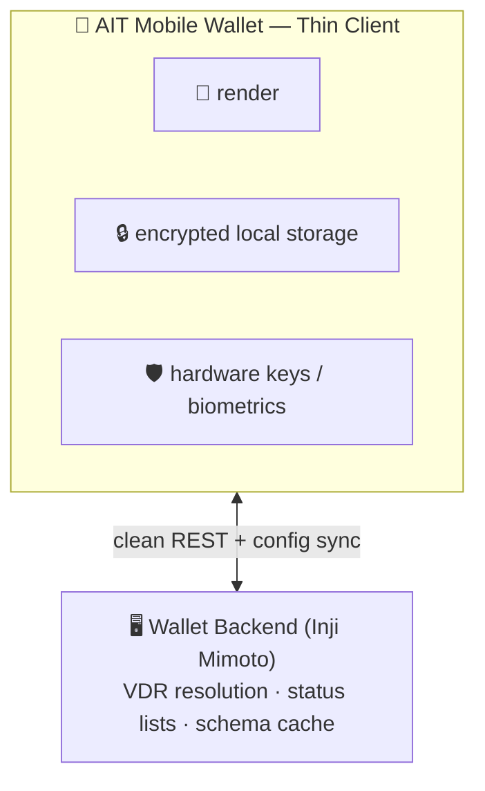
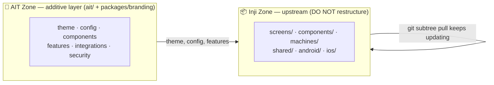
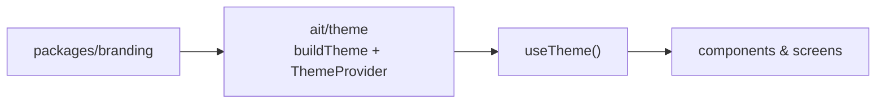

# AIT Wallet — Mobile App Architecture

**Status:** Proposal for review · **Owner:** Saina (Mobile) · **Phase:** 1

This PR proposes the mobile app **code structure** and the **configuration
model** (per 12 Oct MoM). It is built as an **additive layer** over the MOSIP
Inji base and implements the Thin Client in `docs/ARCHITECTURE.md §6` and the
Prime Directives in `AGENTS.md`.

> Scope: **structure + the configuration mechanism**. Feature code is out of
> scope here — feature folders are placeholders that show the pattern, built in
> later PRs once the Inji base is merged.

---

## 1. Principle: a Thin Client

Per Directive #7, the app does not parse registries, decompress status lists, or
federate trust. It renders, stores, and signs; the BFF (Inji Mimoto) does the
heavy lifting.



---

## 2. Two-Zone Model ⭐

We extend MOSIP **Inji Mobile** (production-proven, XState-driven, flat layout).
Rather than refactor it, we keep two separated zones:



| Zone | Rule |
| :--- | :--- |
| **Inji Zone** | keep as-is; update via `git subtree pull` |
| **AIT Zone** (`ait/` + `packages/branding`) | our clean, configurable layer |

**Reuse, don't rebuild:** credential core and biometric unlock already exist in
Inji — the AIT layer extends them, never duplicates them.

---

## 3. Code structure

```
apps/mobile/
├── ait/
│   ├── theme/          ✅ configurable theme (consumes packages/branding)
│   ├── config/         ✅ runtime config (env + BFF remote)
│   ├── components/     ▫️ reusable AIT UI (token-driven)
│   ├── features/       ▫️ feature-first: screen + machine + types per feature
│   ├── integrations/   ▫️ AIT backend clients (repository pattern)
│   └── security/       ▫️ AIT auth policies (wrap Inji biometrics)
├── ARCHITECTURE.md
└── .env.example
packages/
└── branding/           ✅ design tokens — the visual configuration surface
```

✅ implemented now · ▫️ structure placeholder (built later)

---

## 4. Configuration model (the point of this PR)

Two surfaces, so **nothing is hardcoded in screens/services**:

### 4a. Visual — design tokens

Re-skin by editing tokens — UI restyles automatically (Directive #2).
`APPLICATION_THEME` (`gradient | purple`, already in Inji's `.env`) = a variant.

### 4b. Runtime — env + remote
`ait/config/runtimeConfig.ts` merges fallback ← `.env` ← BFF remote:

| Setting | Source |
| :--- | :--- |
| Server hosts | `.env` (per deployment) |
| Theme variant, language | `.env` |
| Feature flags | BFF remote (toggle server-side, no app-store update) |

---

## 5. Merge plan (next PR, after Inji is pulled)

Inji's folders map to our layers — **no files moved**:

| Inji Zone | Bridge |
| :--- | :--- |
| `screens/`, `components/` | read tokens via `ait/theme/useTheme()` |
| `machines/` (XState) | AIT feature machines follow the same pattern |
| biometric/auth machines | wrapped by `ait/security` policies (not rebuilt) |
| `.env`, `app.config.ts` | fed by `ait/config/runtimeConfig` |

Everything else stays in the Inji Zone untouched → `subtree pull` stays clean.

---

## 6. Directives honoured

| Directive | Where |
| :--- | :--- |
| #2 Tokens from branding | `ait/theme` consumes `packages/branding`; UI uses `useTheme()` |
| #7 Thin client + reuse | heavy logic + biometrics reused from Inji; AIT adds config/policies |

---

## 7. Scope

- ✅ **In:** `ait/` structure, the theme + runtime-config mechanism, `packages/branding` tokens, this doc.
- ⛔ **Out:** feature implementations and the Inji base import (separate branch).
- 🔎 **Review focus:** the two-zone model, the folder structure, and the two configuration surfaces.
