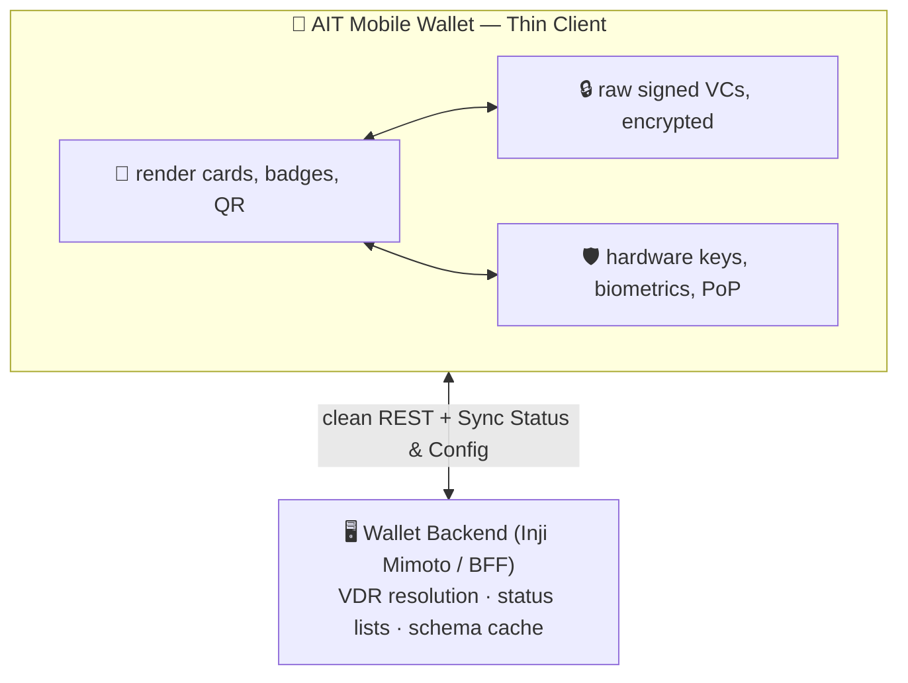
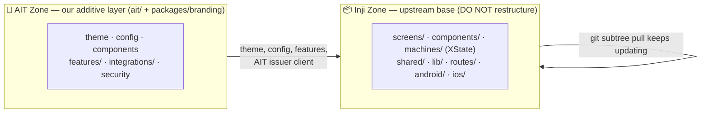
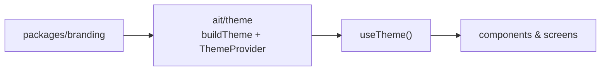

# AIT Wallet — Mobile App Architecture

**Status:** Proposal for review · **Owner:** Saina (Mobile) · **Phase:** 1

Implements the Thin Client principle in `docs/ARCHITECTURE.md §6` and the 8
Prime Directives in `AGENTS.md`. Built as an **additive layer** over the MOSIP
Inji base — contract-first, compiles standalone, binds to Inji on merge.

---

## 1. Principle: a Thin Client

Per Directive #7, the app does not parse multi-VDR registries, decompress status
bitstrings, or federate trust. It renders, stores, and signs:



---

## 2. Two-Zone Model ⭐ (the key decision)

We extend MOSIP **Inji Mobile** — production-proven (government-scale,
XState-driven) but a flat, type-based layout. Rather than refactor it (which
breaks upstream updates for no benefit), we keep two separated zones:



| Zone | Owns | Rule |
| :--- | :--- | :--- |
| **Inji Zone** | `screens/`, `machines/`, `components/`, `shared/`, native | keep as-is; update via `git subtree pull` |
| **AIT Zone** (`ait/` + `packages/branding`) | theme, config, features, integrations, policies | our clean, feature-first, configurable layer |

**Reuse, don't rebuild:** credential download/verify/store/present **and**
biometric unlock already exist in Inji — we extend them, never duplicate them.

---

## 3. AIT Zone — code structure (feature-first)

```
apps/mobile/
├── ait/
│   ├── theme/            # configurable theme (consumes packages/branding)
│   ├── config/           # runtime config (env + BFF remote)
│   ├── components/       # reusable AIT UI (token-driven)
│   ├── features/         # each feature: screen + machine + types together
│   │   ├── transcript/   #   TranscriptScreen · transcript.machine · .types
│   │   └── onboarding/
│   ├── integrations/
│   │   └── ait-api/      # AIT issuer client (repository pattern)
│   └── security/         # AIT auth policies (wraps Inji biometrics)
├── ARCHITECTURE.md
└── .env.example
packages/
└── branding/             # design tokens — the visual configuration surface
```

Dependency direction inside a feature:
**screen → machine (flow) → integration (`ait-api`) → Inji core.**
Screens never verify credentials or manage keys directly.

---

## 4. Configuration model (the priority)

Two surfaces, so **no screen or service hardcodes a value**:

### 4a. Visual — design tokens

Re-skin by editing tokens — components restyle automatically (Directive #2).
`APPLICATION_THEME` (`gradient | purple`, already in Inji's `.env`) = a variant.

### 4b. Runtime — env + remote
`ait/config/runtimeConfig.ts` merges fallback ← `.env` ← BFF remote:

| Setting | Source | Why |
| :--- | :--- | :--- |
| Server hosts | `.env` | per deployment (dev/qa/prod) |
| Theme variant, language | `.env` | per build |
| Feature flags, trust registries | BFF remote | add a feature/country server-side, **zero app-store update** (docs §2.3) |
| Default context domain | BFF remote | AIT / Thailand / India |

---

## 5. Merge plan: how the zones bridge 🔗

On pulling Inji, its folders map to our layers — **no files are moved**:

| Inji Zone | Bridge |
| :--- | :--- |
| `screens/`, `components/` | read tokens via `ait/theme/useTheme()` instead of hardcoded styles |
| `machines/` (XState) | AIT feature machines follow the same pattern; call `ait-api` + Inji storage |
| `shared/` services | AIT calls routed through `ait/config` endpoints |
| biometric/auth machines | wrapped by `ait/security` **policies** (not rebuilt) |
| `app.config.ts`, `.env` | fed by `ait/config/runtimeConfig` |

**Steps (next PR, after merge):** point Inji theming at `ait/theme`; route config
through `runtimeConfig`; have AIT features depend on `ait-api` + Inji storage;
leave everything else in the Inji Zone untouched so `subtree pull` stays clean.

---

## 6. Prime Directives in code

| Directive | Where |
| :--- | :--- |
| #1 No hardcoded schemas | features model the request FLOW, never credential contents |
| #2 Tokens from branding | `ait/theme` consumes `packages/branding`; components use `useTheme()` |
| #6 Tiered accounts | onboarding guest→registered; PID gated by `ait/security` policy |
| #7 Thin client + reuse | storage/biometrics reused from Inji; AIT adds policies/integration only |
| Pillar 3 (context selector) | `config.defaultContext`, presentation-only |

---

## 7. Platform sharing & scope

All of `ait/` is shared TypeScript/React Native; native specifics stay behind
Inji's existing Secure Enclave / Android KeyStore modules.

**In this PR:** the `ait/` layer (theme, config, a feature-first `transcript`
example, `ait-api` contract, auth policy) + `packages/branding` tokens.
**Out:** the Inji base import (separate branch) and full implementations.
**Review focus:** the two-zone model, the feature-first structure, and the two
configuration surfaces.
