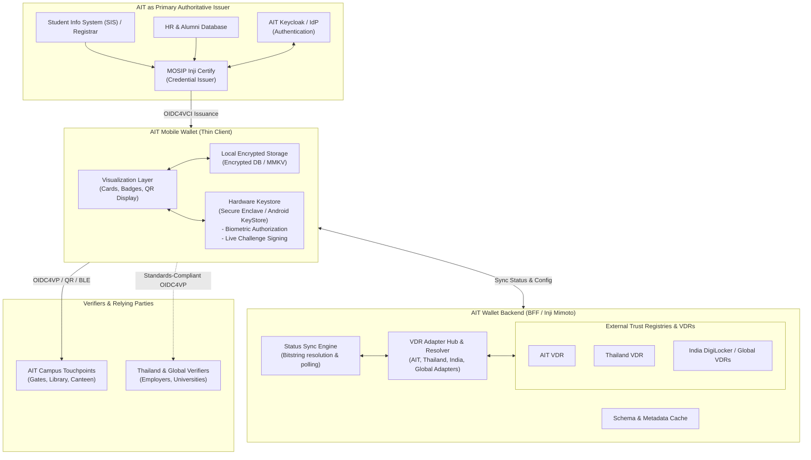
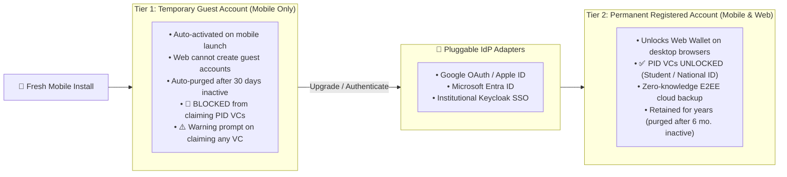
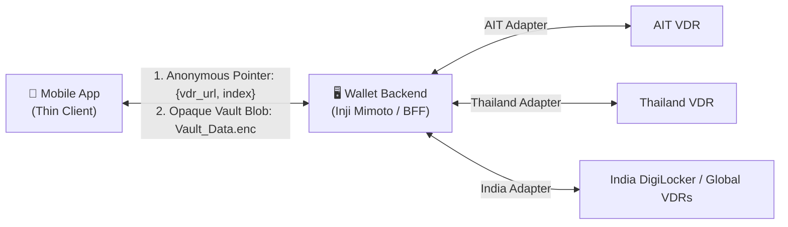

# Technical Architecture & Trust Framework — AIT Wallet

---

## 🏛️ 1. System Architecture

The AIT Wallet operates as a decentralized identity client aligned with the **MOSIP Inji Stack** and the **Thailand Verifiable Credential Trust Framework**.



---

## 🇹🇭 2. Thailand Trust Framework Alignment

The wallet adopts open digital credential standards recognized in **Thailand** to ensure full national and regional interoperability.

### 2.1 Technical Standards Compliance
| Layer | Specification / Standard | National Alignment Rationale |
| :--- | :--- | :--- |
| **Credential Model** | **W3C Verifiable Credentials Data Model (v1.1 / v2.0)** | Recognized under national guidelines for digital credentials. |
| **Selective Disclosure** | **IETF SD-JWT (Selective Disclosure JWT)** | Enables attribute redaction (e.g. sharing degree status without full grade history). |
| **Issuance Protocol** | **OpenID for Verifiable Credential Issuance (OIDC4VCI)** | Standard API for mobile wallets communicating with accredited national issuers. |
| **Presentation Protocol**| **OpenID for Verifiable Presentations (OIDC4VP)** | Standard protocol for in-person (QR/BLE) and web-based verification. |
| **Cryptographic Algorithms** | **ECDSA (secp256r1), Ed25519, SHA-256** | Standard cryptographic suites mandated by national / NIST standards. |
| **Status / Revocation** | **W3C Bitstring Status List / StatusList2021** | High-efficiency, privacy-preserving bit-indexed status checks. |

### 2.2 Universal Interoperability & Contextual PID
- **The Wallet Does Not Hardcode "PID"**: Person Identification Data (PID) is not an intrinsic property of the wallet; it is defined by the **Governance Authority (VCGA)** and required by the **Verifier**.
  - Under AIT's VCGA, AIT Student/Staff ID serves as the campus PID.
  - Under Thailand's VCGA, the Thai National Digital ID serves as the national PID.
  - Under India's VCGA, Aadhaar/National ID serves as the PID.
- **The Wallet as a Neutral Container**: The wallet securely holds any standards-compliant credential. When interacting with a verifier, the wallet inspects the verifier's presentation request and presents whichever accredited PID or credential the verifier asks for.

### 2.3 Cross-Border Trust: The Federated VDR / Trust Hub Pattern
To support students and alumni from countries like **India (DigiLocker / Aadhaar)**, **Japan**, and **Indonesia (INA Digital)**, AIT implements a **Backend Federated VDR (Trust Hub)**:

```text
┌─────────────────┐       ┌─────────────────┐       ┌─────────────────┐
│    Thailand     │       │India(DigiLocker)│       │ Japan / Indo    │
└────────┬────────┘       └────────┬────────┘       └────────┬────────┘
         │                         │                         │
         └────────────────► ┌──────▼────────┐ ◄──────────────┘
                            │    AIT VDR    │ (Trust Hub / Federation Anchor)
                            │ (VCGA Server) │
                            └──────┬────────┘
                                   │ Single Normalized OIDFed Endpoint
                                   ▼
                            ┌───────────────┐
                            │  AIT Wallet   │
                            └───────────────┘
```

- **Zero App Store Updates**: New national trust registries are integrated at the server level. The mobile wallet does not need app store updates to support new countries.
- **Institutional Governance**: The AIT VCGA decides which international issuers are trusted, preventing fraudulent foreign credential claims.
- **Protocol Normalization**: The backend handles country-specific variations, keeping the mobile client clean and fast.

---

## 👤 3. Tiered Account Architecture: Guest to Permanent Upgrade

To eliminate initial onboarding friction while protecting sensitive identity credentials and controlling cloud storage costs, the wallet implements a progressive two-tier account model:



### 3.1 Tier 1: Temporary Guest Account (Mobile Only)
- **Zero Registration Barrier**: Created automatically on fresh mobile installation without requiring credentials. (*Web clients cannot create guest accounts; Web requires authentication*).
- **Claim Warning UX**: When a guest attempts to claim any VC, the wallet displays a clear warning modal:
  > ⚠️ *Guest Mode Notice: You are using a temporary Guest Account. If you uninstall the app, your credentials will be lost. Upgrade anytime to secure your wallet.*
- **Strict PID Guard**: The mobile client **strictly blocks claiming any Person Identification Data (PID)** (Student ID, National ID, Faculty ID). PIDs legally require a verified, authenticated identity.
- **Allowed Credentials**: Ephemeral, non-PID credentials (visitor day passes, event meal vouchers, temporary Wi-Fi access tokens).
- **Inactivity Deletion**: Temporary accounts and local data inactive for **30 days** are automatically purged.

### 3.2 Tier 2: Permanent Registered Account (Multi-Platform)
- **Seamless In-Place Upgrade**: Upgrading does not wipe the wallet. The existing vault, cryptographic keypairs, and non-PID vouchers are smoothly migrated into the permanent account.
- **Pluggable Identity Providers (IdPs)**:
  - **Social / Consumer**: Google OAuth, Apple Account, Microsoft Account.
  - **Enterprise / Higher Ed**: Institutional SSO (Keycloak, OpenID Connect, SAML).
- **Full PID Capabilities**: Users can claim, store, and present official foundational PIDs, academic transcripts, and professional certifications.
- **Cross-Platform Access**: Unlocks full access to the **Web Wallet** on desktop browsers.
- **Storage Lifecycle & Cost Management**: Maintained across years of active use. Inactive accounts are flagged and purged after **6 months** of continuous inactivity to prevent unbounded server storage costs.

---

## 🏛️ 4. Issuer Architecture: AIT as Authoritative Issuer

AIT operates the issuing authority for both identity and academic records:

1. **Student Information System (SIS) / ERP Integration**:
   - Manages enrolled student records, semester grades, and graduation conferrals.
   - Pushes verified events to **Inji Certify**.
2. **Inji Certify (Issuing Engine)**:
   - Signs credentials using AIT's cryptographic key stored in a secure key management system.
   - Exposes OIDC4VCI endpoints for credential offer, token exchange, and credential download.
3. **Trust Registry**:
   - AIT hosts its public DID document and verification keys at `https://id.ait.ac.th/.well-known/did.json` and connects to national and global trust registries.

---

## 🖥️ 5. Wallet Backend Architecture (BFF / Inji Mimoto)

All heavy integration logic, VDR routing, and status synchronization reside on the **Wallet Backend (BFF / Inji Mimoto)**. The backend acts as a **Zero-Knowledge Encrypted Data Vault (EDV)** and **Universal VDR Gateway**, shielding client apps from external registry complexities:



### Core Backend Responsibilities:

#### 5.1 Zero-Knowledge Encrypted Data Vault (Envelope Encryption)
* **W3C EDV & WebAuthn PRF Alignment**: Implements **Envelope Encryption with Multi-Recipient Key Wrapping** (similar to Apple iCloud Keychain, Signal SVR, Matrix SSSS, and 1Password).
* **DEK / KEK Separation**:
  * **Master Vault Key (`K_vault`, DEK)**: 256-bit AES-GCM key locking all VCs and the holder's keychain into `Vault_Data.enc`.
  * **Per-Device Key Wrappers (KEK)**: Derived locally via WebAuthn PRF (or Argon2id PIN on budget phones). Each device uploads a ~64-byte wrapper.
* **Server-Blind Storage**: The BFF stores only opaque ciphertext. The server has **zero access to plaintext credentials, student IDs, grades, or private keys**.

#### 5.2 VDR Gateway & Anonymous Status Pointer (Privacy Guard)
* **Zero User Tracking**: When checking if a credential is active, the wallet **never** sends the credential or personal claims to the BFF.
* **Anonymous Query**: The client sends only the anonymous pointer:
  `GET /status?vdr_url=https://...&index=4209`
* **Status Bitstring Normalization**: Mimoto decompresses gzip-compressed bitstring lists from external VDRs, checks the bit index (0 = Active, 1 = Revoked), and returns `{ "status": "ACTIVE" }` in milliseconds.
* **Zero Presentation Tracking**: Live presentations occur strictly peer-to-peer (P2P) between the phone and the verifier over OIDC4VP or NFC. The BFF is not in the presentation loop and logs no verifications.

#### 5.3 Separation of Custody from Governance
* **Agnostic Digital Leather Wallet**: The wallet holds and presents credentials from any issuer worldwide.
* **Server-Side Registry Integration**: Pluggable adapters (`did:web`, `did:jwk`, Thailand Trust Framework, India DigiLocker, OpenID Federation 1.0) are maintained on Mimoto with **zero App Store releases**.
* **Graceful Degradation**: If a credential references an unsupported VDR, the wallet still securely holds and presents it; the UI gracefully marks the status as `[⚪ STATUS UNCHECKED]`, delegating verification to the verifier.

---

## 📱 6. Mobile Application Architecture (Thin Client)

The mobile application is deliberately designed as a **Thin Client**: its primary responsibilities are **visualization**, **secure local storage**, and **hardware-backed proof of possession**:

```text
apps/mobile/
├── src/
│   ├── ui/                   # 1. Visualization & UX Layer
│   │   ├── screens/          # Home, Card Detail, QR Scanner, History, Settings
│   │   ├── components/       # Card renderers, Status Badges (Active/Revoked), QR codes
│   │   └── theme/            # AIT Brand design tokens (packages/branding)
│   ├── storage/              # 2. Local Encrypted Storage
│   │   ├── vc-store/         # SQLCipher / Encrypted MMKV storing raw signed VCs
│   │   └── profile-store/    # Registered account profile or Guest session state
│   └── security/             # 3. Hardware & Software Security Layer
│       ├── keystore/         # Hardware Keystore Bridge (Secure Enclave / StrongBox / TEE)
│       ├── emulator/         # SoftwareKeymaster Fallback (Argon2id + AES-GCM for budget devices)
│       ├── biometrics/       # Face ID / Touch ID / BiometricPrompt authorization
│       └── presentation/     # Signs live challenge nonces (Proof of Possession)
```

### 6.1 Universal Hardware Inclusivity Tier (DPI Principle)
To prevent excluding users with budget smartphones, the crypto layer employs graceful hardware degradation:
1. **Tier 1 (Flagship / Discrete HSM)**: Apple Secure Enclave & Android StrongBox.
2. **Tier 2 (Standard / Budget ARM)**: ARM TrustZone (TEE) hardware-isolated KeyStore (present on 95%+ of $50–$80 Android devices).
3. **Tier 3 (Ultra-Budget / Legacy Fallback)**: **Software Keystore Emulation (`SoftwareKeymaster`)** using **Argon2id memory-hard key derivation** + local AES-GCM sandboxing (MMKV/SQLCipher). Encryption at rest is an unbroken invariant.

### 6.2 Device-Bound vs. Multi-Device Credentials ("View-Only" Presentation Guard)
* **Class A: Multi-Device Credentials (SD-JWT)**: Academic Transcripts and Student IDs bound to `K_holder` in the E2EE vault are presentable across iPhone, Android, and Desktop Web.
* **Class B: Single-Device Regulated Credentials (mdoc)**: High-assurance credentials where the issuer mandates non-exportability are bound permanently to that phone's **Secure Enclave silicon**. By Apple/Android design, Secure Enclave keys never sync across devices (even between two iPhones with the same Apple ID).
* **The "View-Only" UX Guard**: Synced devices without the physical enclave key can decrypt and visualize card claims (photo, student ID, expiry), but live hardware presentation is disabled (`[👁️ mdoc (View Only: Locked to Device 1)]`) while auto-serving the SD-JWT payload for web sessions.
