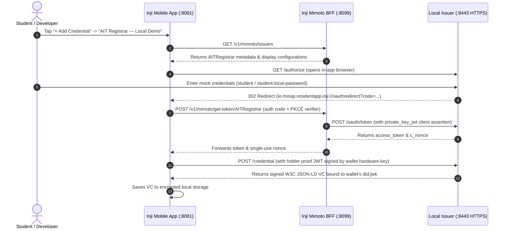

# Local Development Mock Issuer & Testing Guide

This guide describes how to run and test against the **fictional local development issuer** located in [`tools/local-issuer`](../tools/local-issuer).

The local issuer simulates an authoritative university credential issuer (**AIT Registrar**) conforming strictly to international standards ([OIDC4VCI](https://openid.net/specs/openid-4-verifiable-credential-issuance-1_0.html), W3C Verifiable Credentials JSON-LD, and [`schema.org/EducationalOccupationalCredential`](https://schema.org/EducationalOccupationalCredential)). It allows developers to test end-to-end credential issuance and verification on local simulators/emulators without external network dependencies or live institutional IdP access.

---

## 🏛️ Architecture & Integration Flow

The local development stack consists of three coordinated components:



### Key Security & Protocol Properties
* **Mutual Client Authentication (`private_key_jwt`)**: Mimoto authenticates to the issuer using an RSA keypair stored in its local PKCS#12 keystore (`oidckeystore.p12`), mapped to the registered `ait-wallet-mobile-client` alias.
* **PKCE Enforcement**: Authorization code exchange mandates `S256` PKCE code challenge and verifier matching.
* **Cryptographic Holder Binding**: The issued credential is tied to the wallet's public key as `did:jwk:...` using a signed `openid4vci-proof+jwt` proof of possession.
* **Standards-Based Vocabularies**: No proprietary schema definitions exist in this repository (in strict accordance with [AGENTS.md](../AGENTS.md)). Claims use global `schema.org` terms and standard `eduPersonAffiliation` OIDs.

---

## 🚀 Quick Start (Automated)

To spin up Mimoto BFF together with the local issuer:

```bash
cd apps/bff
./scripts/start-local-issuer.sh
```

### What `start-local-issuer.sh` Does:
1. Ensures [`apps/bff/.env`](file:///mnt/pool-1/home/akraradets/projects/MOSIP-asia/ait-wallet/apps/bff/.env) exists (copied from `.env.example`).
2. Runs [`generate-keystore.sh`](file:///mnt/pool-1/home/akraradets/projects/MOSIP-asia/ait-wallet/apps/bff/scripts/generate-keystore.sh) to create a local Mimoto keystore (`certs/oidckeystore.p12`).
3. Starts the baseline Mimoto container and PostgreSQL database.
4. Executes [`tools/local-issuer/scripts/setup.py`](file:///mnt/pool-1/home/akraradets/projects/MOSIP-asia/ait-wallet/tools/local-issuer/scripts/setup.py):
   * Generates a local Development Root CA (`ca.pem` / `ca.der`) and localhost TLS certificate.
   * Generates issuer RSA signing keys and client keypairs.
   * Imports the client key into Mimoto's PKCS#12 keystore under alias `ait-wallet-mobile-client`.
   * Exports Mimoto's JVM truststore and imports the local Development CA, so Mimoto trusts the issuer over TLS.
5. Launches `config-server`, `mimoto`, and `local-issuer` via `docker compose -f docker-compose.yml -f docker-compose.local-issuer.yml`.

---

## 🔒 Trusting the Local Root CA on Simulators & Emulators

Because `local-issuer` serves over HTTPS (`https://localhost:8443`) using an internal root CA, mobile simulators/emulators must trust the certificate to complete authentication flows.

The certificate files are stored in [`tools/local-issuer/state/`](../tools/local-issuer):
* `ca.pem` (PEM encoded)
* `ca.der` (DER binary encoded)

### A. iOS Simulator (macOS)
Run this command from your terminal while the simulator is booted:
```bash
xcrun simctl keychain booted add-root-cert tools/local-issuer/state/ca.pem
```
Next, enable trust inside the simulator:
1. Open **Settings** → **General** → **About** → **Certificate Trust Settings**.
2. Under "Enable full trust for root certificates", toggle ON **AIT Local Demo Development CA**.

### B. Android Emulator
1. Enable reverse proxying so the emulator can reach host services via `localhost`:
   ```bash
   adb reverse tcp:8099 tcp:8099
   adb reverse tcp:8443 tcp:8443
   ```
2. Push the certificate to the emulator:
   ```bash
   adb push tools/local-issuer/state/ca.der /sdcard/Download/
   ```
3. Inside the Android Emulator:
   * Navigate to **Settings** → **Security** (or **Encryption & Credentials** / **Security & Privacy** → **More Security Settings**).
   * Tap **Install a certificate** → **CA certificate**.
   * Confirm the security warning and select `ca.der` from your `Download` folder.

---

## 🧪 Verifying the Service

### 1. Check Service Health & Endpoints
```bash
# Verify Mimoto health
curl http://localhost:8099/v1/mimoto/actuator/health

# Verify Mimoto configured issuers
curl http://localhost:8099/v1/mimoto/issuers

# Check Local Issuer OIDC4VCI metadata (uses local CA)
curl --cacert tools/local-issuer/state/ca.pem https://localhost:8443/.well-known/openid-credential-issuer

# Check Local Issuer health status
curl --cacert tools/local-issuer/state/ca.pem https://localhost:8443/health
```

### 2. Run Automated Integration Tests
The local issuer includes a comprehensive test suite exercising OIDC discovery, PKCE validation, anti-replay, client assertions, and verifiable credential issuance:

```bash
cd tools/local-issuer
npm test
```

---

## 📱 Connecting Inji Mobile

1. In [`apps/mobile/.env`](../apps/mobile/.env), set:
   ```ini
   MIMOTO_HOST=http://localhost:8099
   ```
   *(Note: If using Android Emulator without `adb reverse`, set `MIMOTO_HOST=http://10.0.2.2:8099`)*

2. Start the mobile app:
   ```bash
   cd apps/mobile
   npm start
   # In another terminal:
   npm run android:mosip   # For Android
   # OR
   npm run ios             # For iOS
   ```

3. In the Inji Mobile app:
   * Tap **+ Add Credential** / **Download Credential**.
   * Select **AIT Registrar — Local Demo**.
   * On the login page, enter the mock student credentials:
     * **Username**: `student`
     * **Password**: `student-local-password`
   * Tap **Sign in and issue student ID**.
   * The credential for **Nisha Gurung** (`DEMO-2026-0002`) will download and appear on your wallet home screen.

---

## 📋 Endpoints & Mock Identity Reference

| Endpoint / Item | Location / Value | Description |
| :--- | :--- | :--- |
| **BFF Host** | `http://localhost:8099` | Inji Mimoto backend port |
| **Local Issuer Origin** | `https://localhost:8443` | OIDC4VCI mock server |
| **Issuer Discovery** | `/.well-known/openid-credential-issuer` | OIDC4VCI issuer configuration |
| **OAuth Authorization** | `/authorize` | Interactive mock login page |
| **Token Endpoint** | `/oauth/token` | PKCE + `private_key_jwt` token exchange |
| **Credential Endpoint**| `/credential` | W3C JSON-LD issuance with holder binding |
| **Mock Username** | `student` | Demo login account username |
| **Mock Password** | `student-local-password` | Demo login account password |
| **Credential Subject** | Nisha Gurung (`DEMO-2026-0002`) | Issued student profile |
| **Credential Format** | `ldp_vc` (`RsaSignature2018`) | W3C Verifiable Credential 1.0 |

---

## 🧹 Teardown & Reset

To stop the containers and clean up:
```bash
cd apps/bff
docker compose -f docker-compose.yml -f docker-compose.local-issuer.yml down
```

To perform a complete clean reset (wiping DB state, generated keystores, and certificates):
```bash
cd apps/bff
docker compose -f docker-compose.yml -f docker-compose.local-issuer.yml down -v
rm -f certs/oidckeystore.p12
rm -rf ../../tools/local-issuer/state
```
Then re-run `./scripts/start-local-issuer.sh` to generate a fresh synchronized environment.

